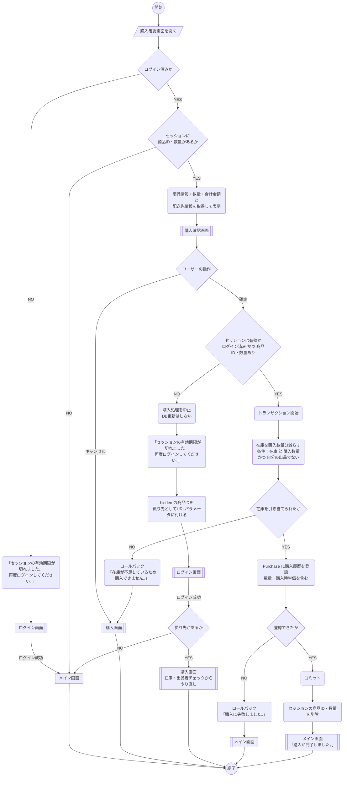

# 購入確認画面_処理手順

凡例（資料の記号との対応）

| 資料の記号 | 図での表し方 |
|---|---|
| 開始・終了（●） | `(( ))` |
| ユーザーの操作 | `[/ /]` |
| 処理内容（角丸） | `( )` |
| 分岐（◇） | `{ }` |
| 画面 | `[[ ]]` |

---



---

## 補足：セッション無効時の考え方

- 確定ボタンを押した時点でセッションが切れていたら、**購入は一切確定させない**
- セッションに保存した商品ID・数量は消えているので、確認画面のフォームに hidden で商品IDを持たせておき、それを戻り先に使う
- ログイン後は確認画面ではなく **購入画面からやり直す**（切れている間に在庫や値段が変わっている可能性があるため）
- 数量は引き継がず、購入画面で入力し直してもらう

## 補足：「在庫を引き当てられたか」の判定

数量が2個以上でも、更新対象は Sales の **商品1行だけ** なので、SQL の更新件数は「成功なら1件／失敗なら0件」になります。図では意味がわかるように「在庫を引き当てられたか」と書いていますが、実装では更新件数で判定します。

| ケース | 在庫 | 購入数量 | 更新件数 | 結果 |
|---|---|---|---|---|
| 在庫が足りる | 5 | 2 | 1 | 在庫 3 になる |
| ちょうど在庫分 | 2 | 2 | 1 | 在庫 0 になる |
| 在庫が足りない | 1 | 2 | 0 | エラー |
| 自分の出品 | 5 | 1 | 0 | エラー |

異なる商品をまとめて買う（カート）場合は、商品ごとにこの処理を繰り返し、**1つでも0件ならトランザクション全体をロールバック**します。

## 補足：購入確定時のSQL（例）

```sql
BEGIN TRANSACTION;

-- ① 在庫を購入数量分減らす（同時購入対策・自分の出品は不可）
UPDATE Sales
SET Stock           = Stock - @Quantity,
    UpdateUserId    = @LoginUserId,
    UpdatedDateTime = GETDATE()
WHERE ProductID = @ProductID
  AND Stock >= @Quantity
  AND Userid <> @LoginUserId;

-- 更新件数が 0 件なら ROLLBACK して「在庫不足」エラー

-- ② 購入履歴を登録（単価は購入時点の Sales.Price）
INSERT INTO Purchase (ProductID, BuyerUserid, Quantity, UnitPrice,
                      SoldDate, ShippingFlag, InsertUserId, InsertDateTime)
SELECT ProductID, @LoginUserId, @Quantity, Price,
       GETDATE(), 0, @LoginUserId, GETDATE()
FROM Sales
WHERE ProductID = @ProductID;

COMMIT;
```

- `Stock >= @Quantity` を WHERE に入れることで、2人が同時に確定しても在庫がマイナスにならない
- 在庫の減算と履歴の登録は同じトランザクションで行い、片方だけ成功する状態を防ぐ
- 値は必ずパラメータ（`@〜`）で渡し、文字列連結でSQLを組み立てない（SQLインジェクション対策）
