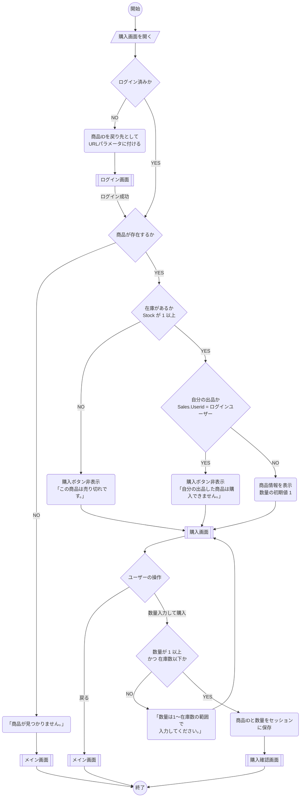

# 購入画面_処理手順

凡例（資料の記号との対応）

| 資料の記号 | 図での表し方 |
|---|---|
| 開始・終了（●） | `(( ))` |
| ユーザーの操作 | `[/ /]` |
| 処理内容（角丸） | `( )` |
| 分岐（◇） | `{ }` |
| 画面 | `[[ ]]` |

---



---

## 補足：ログイン後の戻り先

- ログイン画面へ飛ばすときは、商品IDを戻り先としてURLパラメータに付ける（例：`/login?return=/purchase?productId=123`）
  - セッション切れの場合はセッションに保存した値も消えているため、URLで渡す
- ログイン成功時に戻り先があればそこへ遷移し、なければメイン画面へ遷移する
- 戻り先URLは自サイト内のパスだけ許可する（外部サイトへ飛ばされる対策）

## 補足：商品情報取得のSQL（例）

```sql
SELECT s.ProductID, s.ProductName, s.Price, s.Stock, s.Userid,
       g.GenreName, u.UserName AS SellerName
FROM Sales s
JOIN Genre    g ON s.GenreCode = g.GenreCode
JOIN UserData u ON s.Userid    = u.Userid
WHERE s.ProductID = @ProductID;
```
