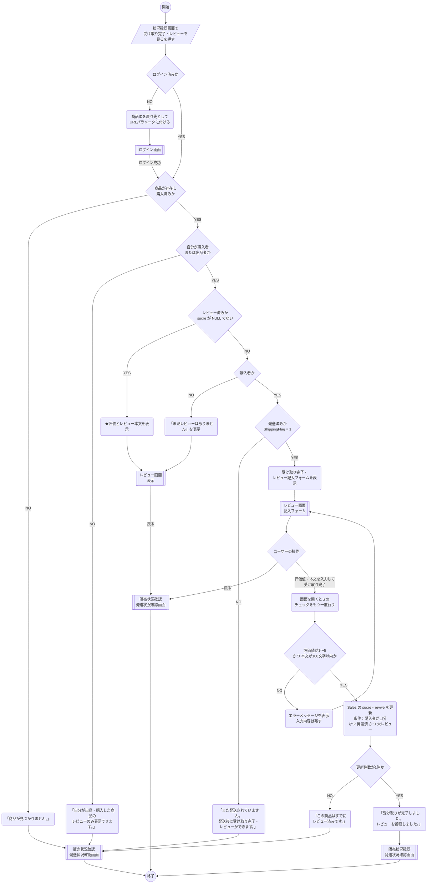

# レビュー画面_処理手順

凡例（資料の記号との対応）

| 資料の記号 | 図での表し方 |
|---|---|
| 開始・終了（●） | `(( ))` |
| ユーザーの操作 | `[/ /]` |
| 処理内容（角丸） | `( )` |
| 分岐（◇） | `{ }` |
| 画面 | `[[ ]]` |

---



---

## 補足：レビュー登録のSQL（例）

```sql
UPDATE Sales
SET sucre = @Score,
    revwe = @Review          -- 空なら NULL
WHERE ProductID    = @ProductID
  AND BuyerName    = @Buyer  -- 自分が購入した商品
  AND ShippingFlag = 1       -- 発送済み
  AND sucre IS NULL;         -- まだレビューしていない（二重投稿対策）
```

- 条件を WHERE に全部入れておくことで、画面を開いた後に状態が変わっても不正な更新はされない
- 更新件数が 0 件ならレビュー済み（または条件を満たしていない）としてエラーにする
