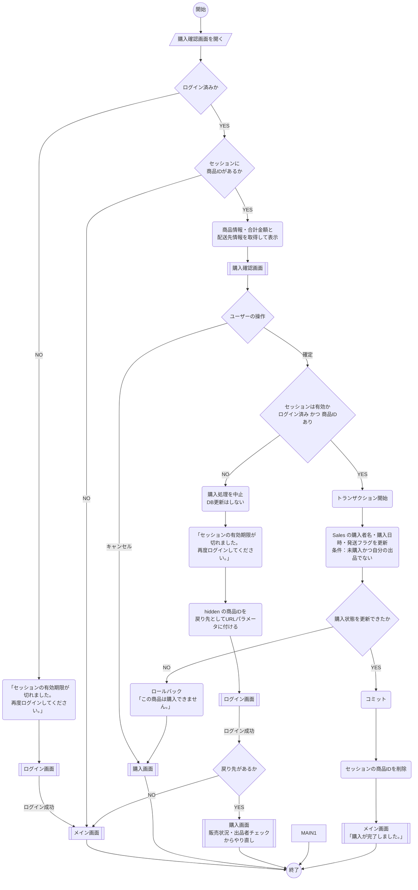

# 購入確認画面_処理手順

凡例（資料の記号との対応）

| 資料の記号 | 図での表し方 |
|---|---|
| 開始・終了（●） | `(( ))` |
| ユーザーの操作 | `[/ /]` |
| 処理内容（角丸） | `( )` |
| 分岐（◇） | `{ }` |
| 画面 | `[[ ]]` |

---



---

## 補足：セッション無効時の考え方

- 確定ボタンを押した時点でセッションが切れていたら、**購入は一切確定させない**
- セッションに保存した商品IDは消えているので、確認画面のフォームに hidden で商品IDを持たせておき、それを戻り先に使う
- ログイン後は確認画面ではなく **購入画面からやり直す**（切れている間に販売状況や値段が変わっている可能性があるため）

## 補足：購入確定時のSQL（例）

```sql
BEGIN TRANSACTION;

-- 未購入の商品を購入済みにする（自分の出品は不可）
UPDATE Sales
SET BuyerName = @BuyerName,
    SoldDate = GETDATE(),
    ShippingFlag = 0
WHERE ProductID = @ProductID
  AND BuyerName IS NULL
  AND SoldDate IS NULL
  AND Userid <> @LoginUserId;

-- 更新件数が 0 件なら ROLLBACK して購入失敗

COMMIT;
```

- SQL定義には `Stock` と `Purchase` テーブルがないため、1商品行を1回だけ購入できる状態更新として扱う
- 購入条件を UPDATE の WHERE 句で判定し、同時購入でも購入済み商品が再度確定されないようにする
- 値は必ずパラメータ（`@〜`）で渡し、文字列連結でSQLを組み立てない（SQLインジェクション対策）
